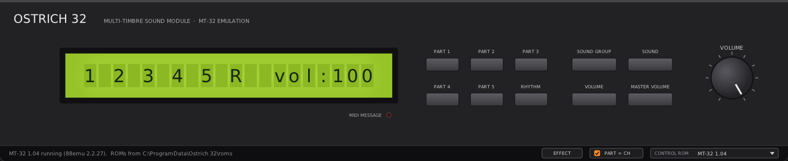
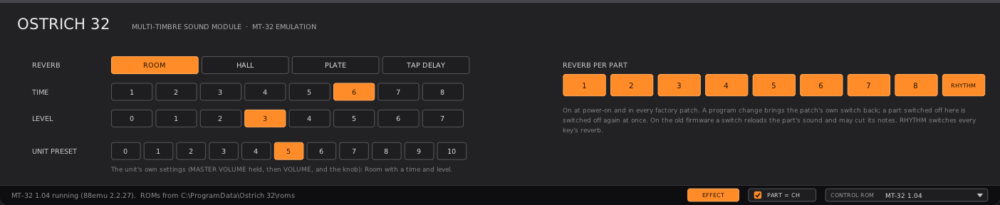

# Ostrich 32 (O-32)

An emulation of the **Roland MT-32** (1987) and its relatives **CM-32L and CM-32LN** as a
VST3/CLAP plugin and a standalone program. A non-commercial fan project, the sibling of
[Ostrich 55](../ostrich-55/),
[Ostrich 220](../ostrich-220/) and
[Ostrich 7765](../ostrich-7765/).

The emulation is **88emu**, part of [gearmulator](https://github.com/dsp56300/gearmulator)
by The Usual Suspects (see [Origin and thanks](#origin-and-thanks)). It runs the unit's
own firmware on an emulated CPU, with emulations of the LA32 sound chip and the Boss
reverb running the original microcode, so the sound, the display, the buttons and the knob
all behave as the firmware makes them. Ostrich 32 adds the plugin around it: VST3, CLAP
and a standalone program, and a panel that looks and handles like the hardware.

You need your own ROM images. **This repository contains no Roland data and never will.**

**[Download Ostrich 32](https://github.com/Helge666/ostrich-not-emu/releases/tag/ostrich32-v0.2.0)** (Windows and Linux zips), or
build it from source ([BUILDING.md](BUILDING.md)).

**Status: 0.2.0, early.** It plays, with a plain panel (display, switches, knob); the
session keeps the unit's setup and the panel's screen, and the EFFECT page reaches the
reverb settings the unit's panel cannot. Separate outputs per part come next
([ROADMAP.md](ROADMAP.md)).

## Installing (Windows)

1. On the release page, under *Assets*, download `Ostrich32-Windows.zip` and unpack it.
2. Copy `Ostrich32.vst3` to `C:\Program Files\Common Files\VST3\`, or `Ostrich32.clap` to
   `C:\Program Files\Common Files\CLAP\`. The zip's `INSTALL.txt` also covers the
   standalone program and Linux.
3. Load Ostrich 32 in your DAW (or start `Ostrich32.exe`). The first time, it asks for the
   ROM images: click **CHOOSE FILE** and pick any one of your MT-32 or CM-32L ROM images, or
   a zip with them. The others in the same folder are found by their contents and copied to
   `C:\ProgramData\Ostrich 32\roms\`. Which images: [roms/README.md](roms/README.md).
4. With **PART = CH** ticked in the bar (the default), MIDI channel 1 plays PART 1, channel 2
   PART 2 and so on to 8; the rhythm part is on channel 10. Untick it and the MT-32 hears the
   channels as they come, as the unit does: PART 1 on channel 2 up to PART 8 on channel 9.
5. The session keeps the unit's setup: the sound each part plays, levels, pans, reverb,
   master volume, whatever came by program change or SysEx or from the panel -- and the
   screen the panel was left on (PART 4 with VOLUME, say), which it shows again.
6. **EFFECT** in the bar shows, in the unit's place, what the unit's panel cannot reach
   (click it again for the unit): the reverb's mode
   (Room, Hall, Plate, Tap Delay), time and level, the unit's own reverb presets 0-10, and
   the reverb on or off per part and for RHYTHM. A part switched off stays dry after a
   program change, which would otherwise switch it on again.

## Origin and thanks

Ostrich 32 stands on the shoulders of giants.

- **gearmulator / 88emu** ([dsp56300/gearmulator](https://github.com/dsp56300/gearmulator),
  [dsp56300.com](https://dsp56300.com/)) by The Usual Suspects, under the GNU GPL 3: the
  emulation of the board, the 8095 CPU running the firmware, the LA32 and the reverb.
- **Nuked-MT32** by nukeykt ([nukeykt/Nuked-MT32](https://github.com/nukeykt/Nuked-MT32),
  GPL-2.0-or-later): 88emu's LA32 emulation is derived from it, improved and checked
  against the hardware by The Usual Suspects.
- **Sergey V. Mikayev** and **Munt** ([munt/munt](https://github.com/munt/munt)): 88emu's
  emulation of the Boss reverb gate array is derived from his HG61H20R36F emulator in Munt
  (LGPL-2.1-or-later), and its MT-32 ROM catalogue and much of what is known about the
  MT-32 family come from Munt: Dean Beeler, Jerome Fisher, Sergey V. Mikayev and the Munt
  contributors. Ostrich 32's first core was built on Munt's libmt32emu.
- 88emu's own credits (`third_party/gearmulator/doc/88emu_readme.md`) name many more: MAME and
  mamedev, the DTM MIDI Central community, the die-shot photographers and others.
- Ostrich 32 uses gearmulator from our fork
  [Helge666/gearmulator](https://github.com/Helge666/gearmulator), pinned to a tag on its
  branch `ostrich`: the upstream release plus only what a mingw-w64 build needs, with
  dsp56300 from [Helge666/dsp56300](https://github.com/Helge666/dsp56300) in the same way.
  Please report bugs you find in Ostrich 32 here, not to The Usual Suspects.
- The plugin follows Ostrich 55 and Ostrich 220, whose structure goes back to Elliott H.
  Liggett's emu110 / Voltaire 110.

Submodules:

| Path | Source | What for |
|---|---|---|
| `third_party/gearmulator/` | [Helge666/gearmulator](https://github.com/Helge666/gearmulator), a fork of [dsp56300/gearmulator](https://github.com/dsp56300/gearmulator), at tag `ostrich-1` (upstream `2.2.27` plus mingw-w64 fixes) | the emulation (88emu) |
| `third_party/dpf/` | [Helge666/DPF](https://github.com/Helge666/DPF), branch `logan` (a fork of [DISTRHO/DPF](https://github.com/DISTRHO/DPF), [DPF-LOGAN.md](../../DPF-LOGAN.md)) | plugin framework |

## Licences

- Ostrich 32 as a whole: GPL-3.0-or-later ([LICENSE](LICENSE)).
- gearmulator and 88emu: GPL-3.0 (`third_party/gearmulator/LICENSE.md`); parts derived from other free
  software keep their licences (Nuked-MT32 GPL-2.0-or-later, the reverb after Munt
  LGPL-2.1-or-later), see `third_party/gearmulator/doc/88emu_readme.md`.
- Third-party code and its licences: [THIRD-PARTY.md](THIRD-PARTY.md).

"Roland", "MT-32", "CM-32L" and "CM-32LN" are trademarks of Roland Corporation. This
project is not affiliated with Roland, and neither are gearmulator, Nuked-MT32 or Munt.
